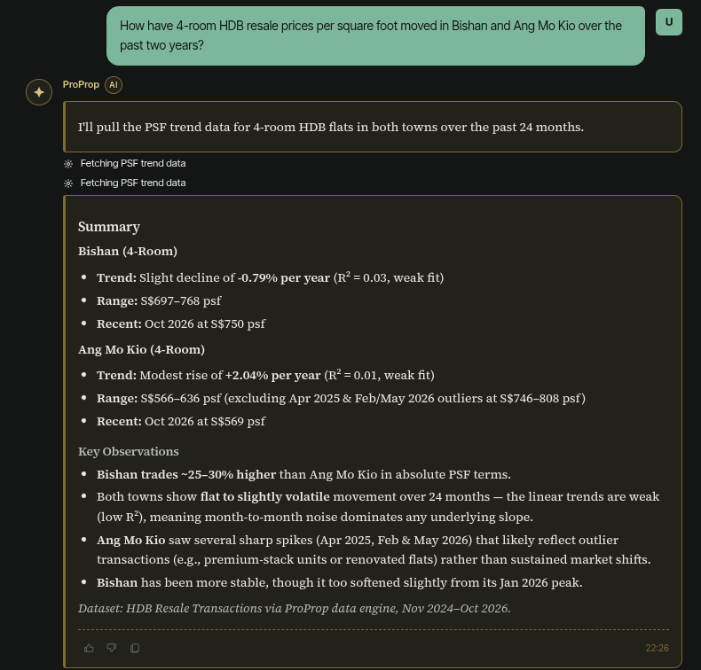
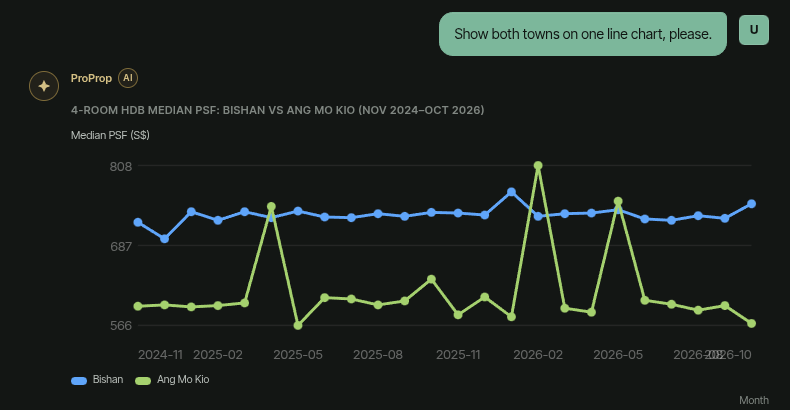
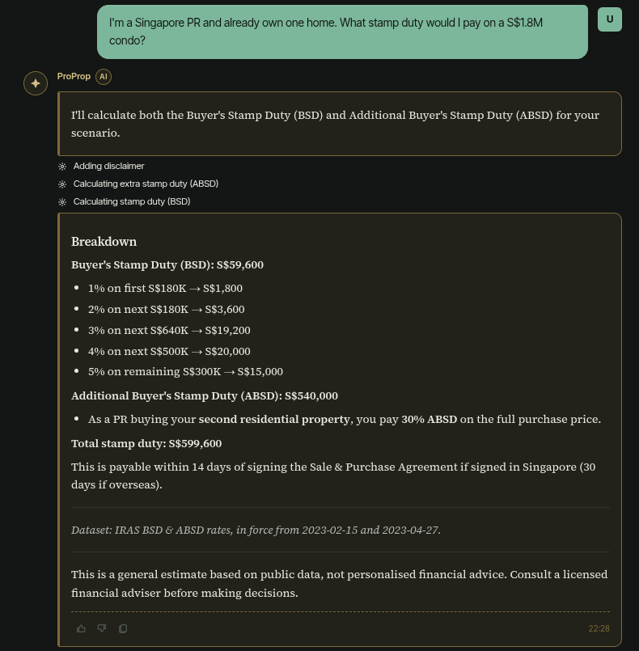
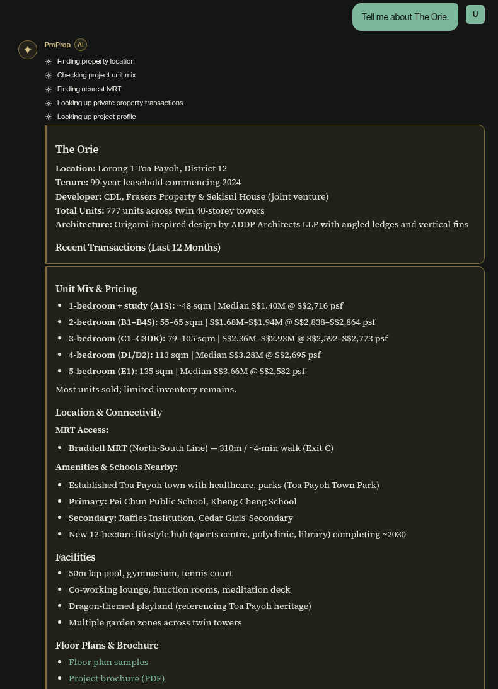
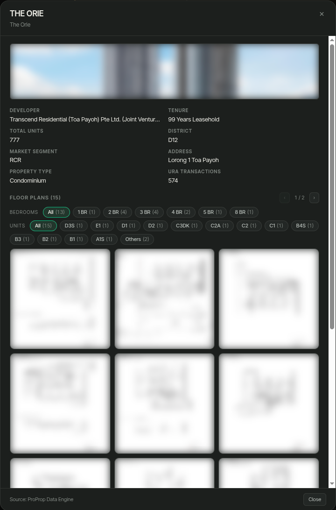
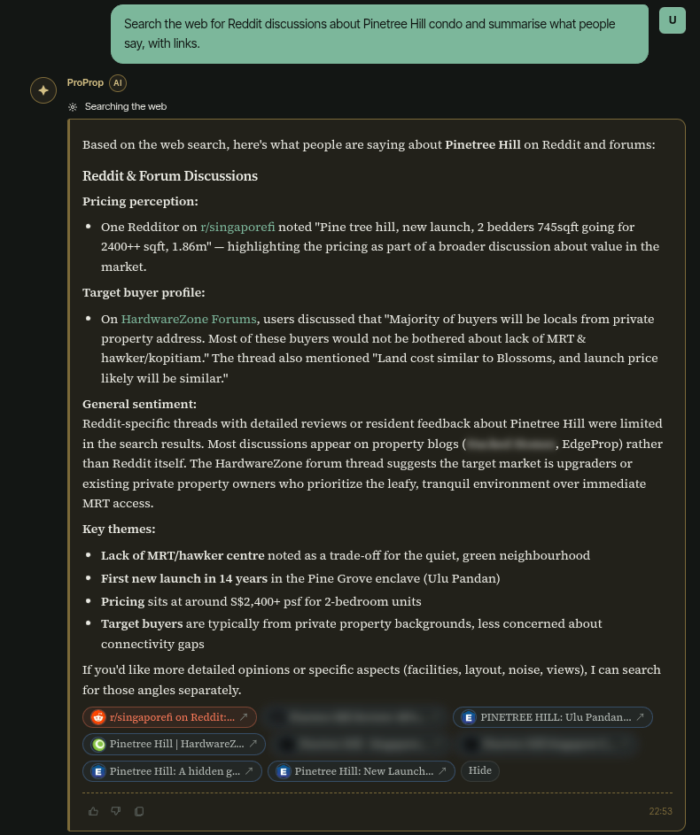
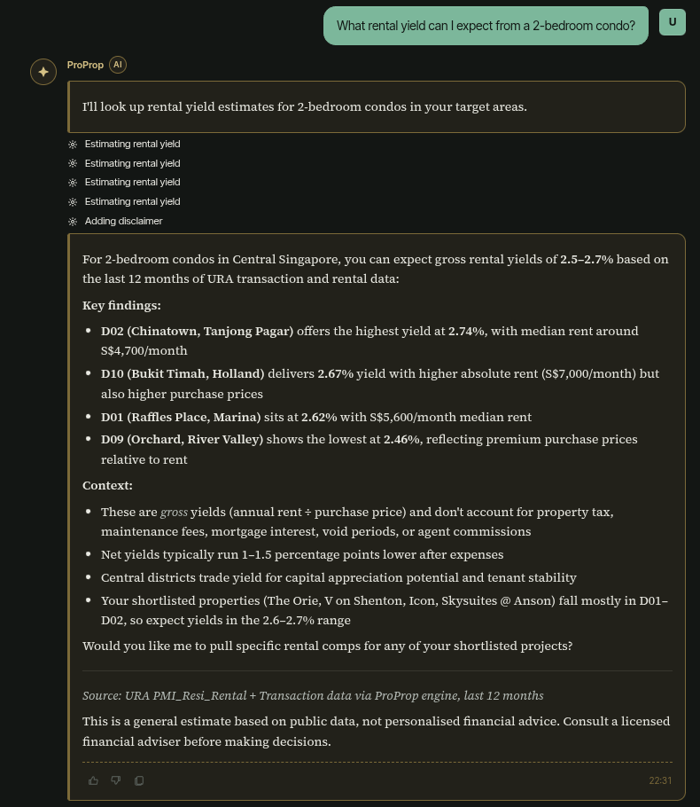
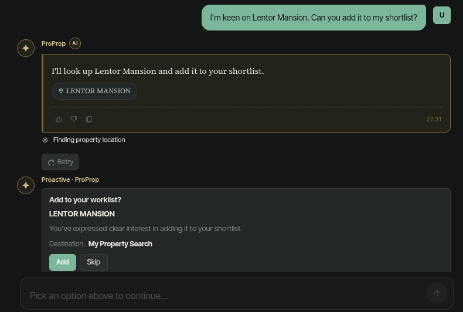

# dialogram

[English](README.md) · **简体中文**

**会画图的对话。** 一个不依赖特定模型厂商的 Go agent 运行时，支持在对话中生成界面、暂停并等待人工参与，以及断线后恢复流式输出。

[](https://github.com/Cyprinus12138/dialogram/actions/workflows/ci.yml)
[](https://goreportcard.com/report/github.com/Cyprinus12138/dialogram)

本项目从 [ProProp](https://proprop.algonavis.com/) 中独立出来。ProProp 是已投入生产使用的新加坡 AI 房产顾问，这个运行时为其提供 53 个工具，并支持网页、iOS 和 Telegram 三端的内嵌生成式界面与人工交互。

## 它能做什么

- **统一的对话格式，支持两家模型厂商。** 对话以不依赖厂商的块式中间表示（block IR）持久化，包含 text / tool_use / tool_result / image。在 OpenAI 上开始的一轮对话可以在 Anthropic 上继续，暂停的工具调用也能稍后恢复，因为存储的状态不依赖任何一家厂商的通信格式。`provider/anthropic` 和 `provider/openai` 是共享执行循环上的轻量适配层。CI 使用手工编写的通信格式样本，对两者进行端到端测试，覆盖跨厂商恢复和含图片的对话，无需联网或 API 密钥。
- **工具结果分为三个通道。** 工具返回一个 `Envelope`，分别包含*供模型读取的内容*（`model_observation`）、*向用户展示的内容*（`ui_payload`，在对话中渲染为图表或表格）和*服务器保留的数据*（`runtime_state`，通过不透明的 artifact 句柄引用原始数据行）。模型通过句柄请求展示表格，原始数据行无需进入模型上下文。`Envelope` 还可以标记为不可信，使模型收到的内容被明确标注为数据，而非指令。
- **根据工具注解执行策略。** 工具可附带 MCP 风格的行为提示（`ReadOnly`、`Destructive`、`Idempotent`、`OpenWorld`）。`agent.PolicyInterceptor` 据此决定暂停或拒绝调用，并与审批名单共用拦截器链。这些提示不会发送给模型。
- **限制工具调用，支持崩溃恢复。** 默认的 `tool.LocalExecutor` 为每次调用设置超时、捕获 panic、限制返回给模型的字节数，并限制并发调用数。超时和 panic 会以软失败结果返回给模型。`Checkpointer` 在每个执行步骤结束时保存对话；发生崩溃后，`CloseDangling` 为尚未返回结果的调用补齐结果，使对话能够在任一厂商的模型上继续。运行时不提供沙箱，工具需自行实现隔离。
- **接入 MCP 服务器的工具。** `tool/mcp` 通过 stdio 或 Streamable HTTP 连接服务器，并为其工具添加服务器专属前缀后注册。服务器的注解会映射为策略提示；对于非自行运营的服务器，可以将其返回结果标记为不可信内容。如果服务器在调用过程中请求用户输入（elicitation），运行会暂停，直到用户回答；两种传输方式均支持此流程。`examples/mcpagent` 是使用单个 MCP 服务器工具的终端 agent；[docs/MCP.md](docs/MCP.md#examples) 提供了连接 [sg-property-engine](https://github.com/Cyprinus12138/sg-property-engine) 的示例。
- **通过工具实现人工参与。** `request_user_input`、`request_user_choice` 和 `request_user_form` 会结束当前轮次并等待用户回答。拦截器链可以暂停任意工具调用以等待审批，应用也可以定义自己的暂停工具。当模型同时请求暂停工具和普通工具时，运行时会按固定规则先执行普通工具，再推迟暂停请求，避免丢弃待执行的工作。`agent.AnswerPause` 恢复暂停的对话时，会为该轮中的每个调用补齐结果，确保后续请求符合两家厂商的协议要求。
- **断线后可恢复的流式输出。** 模型调用由独立于 HTTP 连接的服务器端生产者执行，事件写入 `streambuf.Store`（内存或 Redis）。客户端断线后，携带最后收到的 `id:` 重连，即可补收遗漏的事件，避免因切换标签页、移动设备无线模块休眠或负载均衡切换而丢失回复。
- **支持提示词缓存。** 使用 Anthropic 时，稳定的系统提示词、工具列表和持续增长的对话各设有缓存断点；每轮变化的上下文单独作为不缓存的块发送，避免上下文变化使缓存失效。
- **可评估效果的防编造机制。** 当一轮对话中没有*成功*调用提供依据的工具时，`agent.Guard` 会替换回答中的受监管数值。`eval` 包提供配对的处理前后对比评估，用来检验防护是否在评审模型标记的轮次上生效；防护的设计针对的正是这类评估会暴露的失效模式。
- **运行级链路追踪与指标。** 每次 `Chat` / `ChatStream` 都会生成遵循 GenAI 语义约定的 OpenTelemetry span 树：整个运行对应一个 `invoke_agent` span，每次上游请求对应一个记录 token 和缓存用量的 `chat {model}` span，每次工具调用对应一个记录结果（成功、软失败、超时、panic、拒绝）的 `execute_tool {name}` span。SSE 生产者会接入发起请求的追踪链路。安装 SDK 后才会记录追踪数据。可选的 Prometheus 指标用于跟踪评估框架检查的每轮预算。
- **按需加载技能。** [Agent Skills](https://agentskills.io/specification) 格式（`SKILL.md`）的技能以名称和描述组成目录，放入可缓存的提示词中；模型通过 `load_skill` 工具读取技能说明及附带文件。加载过程按照该格式客户端指南的建议采用宽松校验，`agent.ValidateSkills` 则在 CI 中执行严格校验。

```
browser ── POST /chat/stream?message_id=X&since=N ──▶ sse.Handler ──▶ streambuf.Store (mem | redis)
   ▲                                                      │  Start(X) wins? → go produce()      ▲
   └──── id:<seq> event:<type> data:{…} ◀──── Tail(since) ┘                                    │
                                                          ▼                                    │
                                              agent.Agent.ChatStream ── provider loop ── Append(X, event)
                                              (guard · metrics)        (tools · pauses · cache breakpoints)
```

## ProProp 里的对话

ProProp 的顾问对话由这个运行时驱动。每张截图展示一轮对话，点击可查看原图。

<table>
<tr><td width="25%" valign="top"><a href="docs/images/proprop-parallel-tools.png"></a><br><sub><b>并行工具调用。</b>同一步骤中查询两次走势，回答注明所用数据集。</sub></td><td width="25%" valign="top"><a href="docs/images/proprop-chart.png"></a><br><sub><b>内嵌生成式界面。</b>根据追问，将两个镇的走势绘制在同一张图上。</sub></td><td width="25%" valign="top"><a href="docs/images/proprop-stamp-duty.png"></a><br><sub><b>数字来自工具。</b>BSD 和 ABSD 由按 IRAS 税率表计算的工具给出。</sub></td><td width="25%" valign="top"><a href="docs/images/proprop-project-profile.png"></a><br><sub><b>查一个楼盘。</b>同一步骤中发起五次调用：位置、户型、地铁、成交、概况。</sub></td></tr>
<tr><td width="25%" valign="top"><a href="docs/images/proprop-project-card.png"></a><br><sub><b>楼盘卡片。</b>点击回答里的标签，打开服务器保存的记录；图片属于开发商，已模糊处理。</sub></td><td width="25%" valign="top"><a href="docs/images/proprop-web-search.png"></a><br><sub><b>联网搜索。</b>每条论坛引文都链接到原帖，来源列在下方。</sub></td><td width="25%" valign="top"><a href="docs/images/proprop-rental-yield.png"></a><br><sub><b>每轮上下文。</b>同一步骤中完成四次估算；用户的候选清单作为每轮可变的上下文传给模型。</sub></td><td width="25%" valign="top"><a href="docs/images/proprop-shortlist-pause.png"></a><br><sub><b>应用自定义的暂停。</b>运行暂停，等待用户选择“加入”或“跳过”；在此之前，输入框不可用。</sub></td></tr>
</table>

## 与其他框架的比较

dialogram 是单 agent 运行时，包含一个工具执行循环、传输层和持久化状态。它不是 LangChain 式的集成库，也不提供图编排。

**Vercel AI SDK**（TypeScript）

- 共同能力：通过结束调用等待工具审批、按工具结果类型提供 UI 组件、单独提供面向模型的工具输出，以及可恢复的流式输出。
- dialogram 额外提供：两种适配器均可恢复的持久化 IR、单次工具调用的超时和输出限制、基于注解的策略，以及评估框架。
- dialogram 尚不具备：AI SDK 广泛的模型厂商支持、React / Vue / Svelte 集成及 JavaScript 生态。

**OpenAI Agents SDK**（Python、JS/TS）

- 共同能力：审批时中断并序列化运行状态、通过 stdio 和 Streamable HTTP 接入 MCP、单次工具调用超时，以及链路追踪。
- dialogram 额外提供：可恢复的流式传输、工具结果的 UI 通道、基于注解的策略，以及不依赖平台的评估框架。
- dialogram 尚不具备：agent 间任务移交（handoff）、将 agent 用作工具、通用防护机制（guardrails）、会话存储后端、托管 MCP 工具及实时语音。

**Eino**（Go）

- 共同能力：使用 Go、通过可插拔的检查点存储实现中断与恢复、接入 MCP 工具，以及回调钩子。
- dialogram 额外提供：可恢复的流式传输、三通道 `Envelope`、基于注解的策略、对不可信来源内容的隔离标注，以及经过效果评估的防编造机制。
- dialogram 尚不具备：图与工作流、多 agent、检索组件及 eino-ext 的集成库。

[docs/COMPARISON.md](docs/COMPARISON.md) 比较了九个项目和四种协议，附有能力矩阵和来源。“额外提供”指在截至 2026-10-23 所查阅的对方项目官方文档中未找到相应功能。

## 快速开始

```
go get github.com/Cyprinus12138/dialogram
```

```go
reg := tool.NewRegistry()
tool.RegisterHITL(reg)         // request_user_input / _choice / _form
tool.RegisterPresentData(reg)  // inline metric cards, bar/line charts, tables
tool.RegisterRenderFromRef(reg)
reg.Register(&tool.Tool{
    Name: "get_weather", Description: "Five-day forecast for a city.",
    Schema: tool.Obj(map[string]any{"city": tool.Str("City")}, "city"),
    Fn: func(ctx context.Context, in json.RawMessage) (any, error) {
        rows := lookup(in)
        return &tool.Envelope{
            ModelObservation: summary(rows),                                   // what the model hears
            UIPayload:        &tool.UIPayload{Component: "bar_chart", Data: bars(rows)}, // what the user sees
            RuntimeState:     table(rows),                                     // what the server keeps
            Artifacts:        []tool.ArtifactRef{{ID: tool.ToolUseIDFromContext(ctx), Type: tool.ShapeTableRecord}},
        }, nil
    },
})

cfg := &agent.Config{
    Profiles:       map[string]agent.Profile{"assistant": {SystemPrompt: "You are a concise travel assistant…"}},
    DefaultProfile: "assistant",
}
ag, err := dialogram.New(dialogram.SettingsFromEnv(), dialogram.Deps{
    Registry:     reg,
    Config:       cfg,
    Interceptors: []agent.Interceptor{agent.NewApprovalListInterceptor([]string{"book_flight"})},
    Guard:        agent.NewGuard("get_weather"), // optional
})

out, err := ag.Chat(ctx, agent.ChatInput{Turns: history})
// or stream:
err = ag.ChatStream(ctx, agent.ChatInput{Turns: history}, func(ev agent.StreamEvent) { … })
```

提供支持断线恢复的流式服务：

```go
buf := streambuf.NewMemStore(0) // or streambuf.NewRedisStore(ctx, streambuf.RedisOptions{URL: redisURL})
h := sse.NewHandler(buf, func(ctx context.Context, msgID string, body []byte, emit agent.EmitFn) error {
    history := loadConversation(body)
    return ag.ChatStream(ctx, agent.ChatInput{Turns: history}, emit)
}, sse.Options{OnFinish: func(ctx context.Context, r sse.Result) { persist(r.Turns, r.Paused) }})
mux.Handle("/chat/stream", h)
mux.Handle("/chat/cancel", h.CancelHandler())
```

运行参考服务器，然后打开 http://localhost:8080：

```
ANTHROPIC_API_KEY=… go run ./examples/chatserver
# or any OpenAI-compatible endpoint:
LLM_PROVIDER=openai OPENAI_API_KEY=… OPENAI_BASE_URL=https://api.groq.com/openai/v1 OPENAI_MODEL=llama-3.3-70b-versatile go run ./examples/chatserver
```

示例包含渲染柱状图的天气工具、通过 artifact 句柄展示结果的航班搜索工具、需要审批的订票工具、等待用户选择的暂停流程、内存对话存储，以及刷新页面后可恢复流式输出的原生 JavaScript 客户端。新加坡房产工具改编自 ProProp，包括组屋转售可比成交查询（原始数据行通过 artifact 句柄引用）、价格走势折线图、IRAS 印花税计算器，以及 `propose_shortlist`。后者是应用自定义的暂停工具，只接收楼盘名称，并从服务器自有数据表中读取楼盘信息供用户查看。市场数据工具使用生成的演示数据，楼盘均为虚构。

## 包

| 包 | 内容 |
|---|---|
| `agent` | Block IR、`Provider` 接口约定、`Agent` 封装、配置档案（profiles）、拦截器、暂停检测、技能、防编造机制 `Guard`、可选的 Prometheus 指标、OpenTelemetry 运行 span（`Options.TracerProvider`） |
| `tool` | `Tool`、`Registry`、三通道 `Envelope`、`ArtifactStore`、内置工具（三个人工交互工具、`present_data`、`render_from_ref`、`now`） |
| `tool/mcp` | MCP 工具接入：通过 `Connect` 连接 stdio 或 Streamable HTTP 服务器，通过 `Register` 按服务器前缀注册工具，并将结果转换为注册表支持的格式 |
| `provider/anthropic`、`provider/openai` | 通信协议适配层：格式转换、流解析、缓存断点、重试 |
| `streambuf` | `Store` 接口约定及 `MemStore`、`RedisStore` 实现 |
| `sse` | 支持恢复的 HTTP 处理器：独立生产者、空闲超时监测、取消、gen_ui 转换、`OnFinish` 持久化钩子 |
| `agui` | 面向兼容 CopilotKit 前端的 [AG-UI 协议](https://docs.ag-ui.com) 传输层：将流事件转换为 AG-UI 事件的 `Encoder`、消息与对话轮次互转、每个请求执行一次运行的处理器，以及通过签名 ID 恢复的 AG-UI 中断 |
| `eval` | 回答依据检查、LLM 评审场景、清单固定校验、预算检查、防编造机制 A/B 评估 |
| `dialogram`（根包） | `New` / `NewProvider` / `SettingsFromEnv` |

## 文档

文档目前只有英文版。

- [docs/STREAMING.md](docs/STREAMING.md)：可恢复流式传输的协议与存储接口约定
- [docs/AGUI.md](docs/AGUI.md)：通过 AG-UI 协议提供服务，以及适合使用 AG-UI 而非 `sse` 的场景
- [docs/BLOCK_IR.md](docs/BLOCK_IR.md)：block IR、三通道 `Envelope` 和 artifact 句柄
- [docs/SKILLS.md](docs/SKILLS.md)：Agent Skills 格式、通过 `load_skill` 按需加载内容、校验规则及功能限制
- [docs/MCP.md](docs/MCP.md)：接入 MCP 服务器工具的传输方式、注册流程、结果映射与隔离边界
- [docs/EVAL.md](docs/EVAL.md)：三层评估框架
- [docs/COMPARISON.md](docs/COMPARISON.md)：与九个 agent 框架、四种协议的比较，包括尚未支持的能力
- [docs/HONESTY_AB.md](docs/HONESTY_AB.md)：防编造机制的效果评估方法，以及它需要应对的失效模式
- [docs/OBSERVABILITY.md](docs/OBSERVABILITY.md)：Prometheus 指标和 OpenTelemetry span 模型

## 状态

尚未发布 1.0 版本，公开接口仍可能调整，详见 [CHANGELOG.md](CHANGELOG.md)。

## 许可

[MIT](LICENSE)。Copyright 2026 Mr.Cyprinus (https://github.com/Cyprinus12138)。
